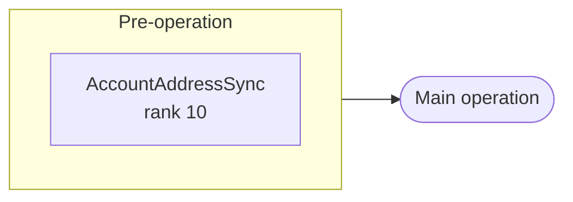
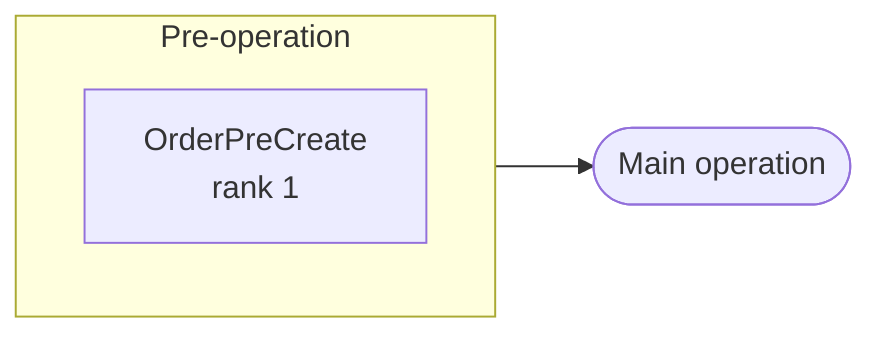
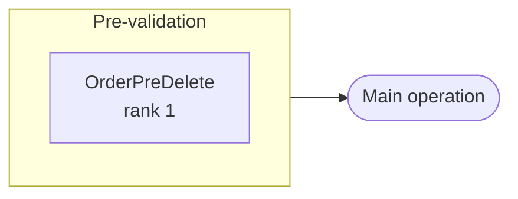
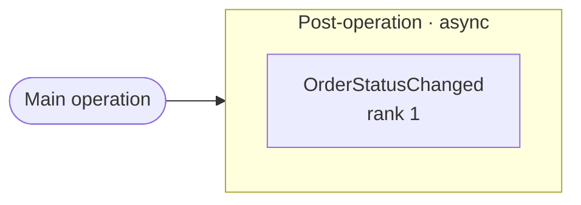
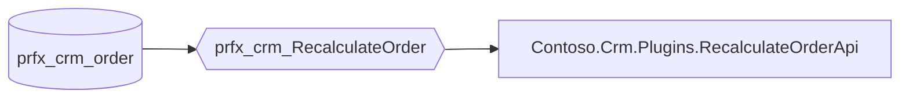

<!-- Generated by dv_plugin_docs.py from the *.dv.plugin.yaml files. Do not edit by hand. -->

# Plug-in registrations

| Source | Kind | Name | Steps | Custom APIs |
|---|---|---|---|---|
| `Contoso.Crm.Plugins.dv.plugin.yaml` | package | prfx_Contoso.Crm.Plugins | 3 | 1 |
| `Legacy.Plugins.dv.plugin.yaml` | assembly | Legacy.Plugins | 1 | 0 |

## Execution pipeline

Steps in the order Dataverse runs them for each table and message: stage, sync before async, then rank. An arrow is a guaranteed order; a dotted line joins sync steps of the same rank, whose order is not guaranteed. Async steps run after the operation, in no guaranteed order.

### Update · account

| # | Stage | Mode | Rank | Step | Plug-in | Filtering attributes | Images | Enabled | Description |
|---|---|---|---|---|---|---|---|---|---|
| 1 | Pre-operation | sync | 10 | Legacy - Account address sync | `Legacy.Plugins.AccountAddressSync` | `address1_city`, `address1_postalcode` | PreImage (pre: address1_city, address1_postalcode) | yes | — |

### Create · prfx_crm_order

| # | Stage | Mode | Rank | Step | Plug-in | Filtering attributes | Images | Enabled | Description |
|---|---|---|---|---|---|---|---|---|---|
| 1 | Pre-operation | sync | 1 | Contoso.Crm.Plugins.OrderPreCreate: Create of prfx_crm_order | `Contoso.Crm.Plugins.OrderPreCreate` | — | — | yes | Sets the order number and the default status. |

### Delete · prfx_crm_order

| # | Stage | Mode | Rank | Step | Plug-in | Filtering attributes | Images | Enabled | Description |
|---|---|---|---|---|---|---|---|---|---|
| 1 | Pre-validation | sync | 1 | Contoso.Crm.Plugins.OrderPreDelete: Delete of prfx_crm_order | `Contoso.Crm.Plugins.OrderPreDelete` | — | PreImage (pre: prfx_ordernumber, prfx_statuscode) | yes | — |

### Update · prfx_crm_order

| # | Stage | Mode | Rank | Step | Plug-in | Filtering attributes | Images | Enabled | Description |
|---|---|---|---|---|---|---|---|---|---|
| 1 | Post-operation | async | 1 | Contoso.Crm.Plugins.OrderStatusChanged: Update of prfx_crm_order | `Contoso.Crm.Plugins.OrderStatusChanged` | `prfx_statuscode` | PreImage (pre: prfx_customerid, prfx_statuscode) | yes | — |

## Custom APIs

### prfx_crm_RecalculateOrder

Recalculates the order total from its lines.

| Property | Value |
|---|---|
| Display name | Recalculate order |
| Kind | action |
| Binding | entity (`prfx_crm_order`) |
| Plug-in | `Contoso.Crm.Plugins.RecalculateOrderApi` |
| Allowed custom steps | async-only |
| Workflow enabled | no |
| Private | no |
| Execute privilege | — |
| Source | `Contoso.Crm.Plugins.dv.plugin.yaml` |

Request parameters:

| Name | Type | Table | Optional | Display name | Description |
|---|---|---|---|---|---|
| `Reason` | string | — | yes | Reason | — |

Response properties:

| Name | Type | Table | Display name | Description |
|---|---|---|---|---|
| `Total` | money | — | Total | — |
