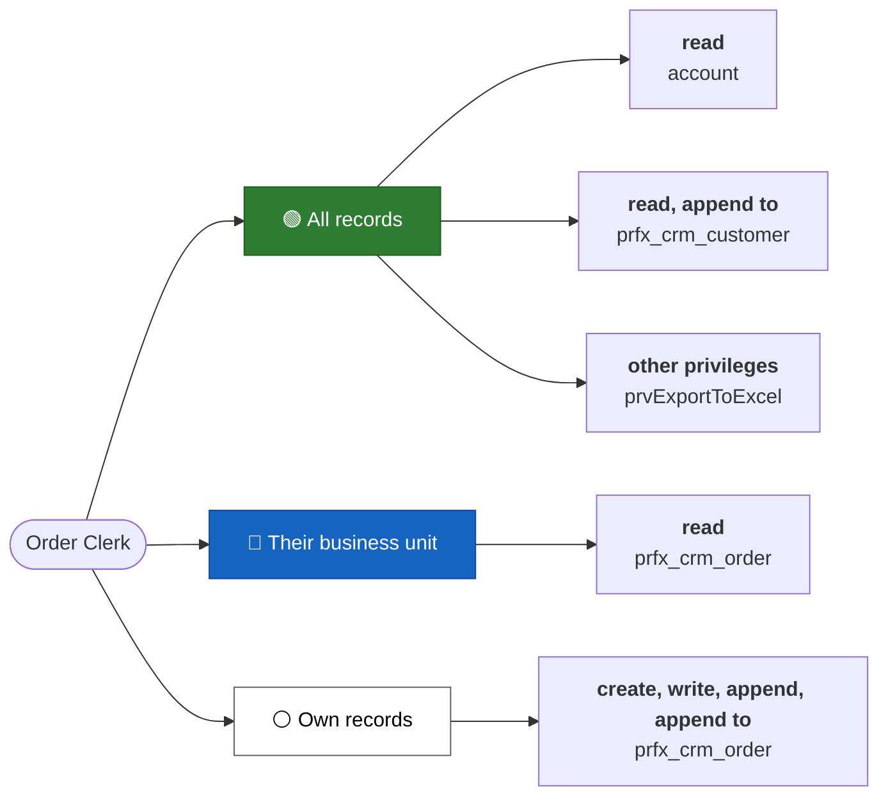
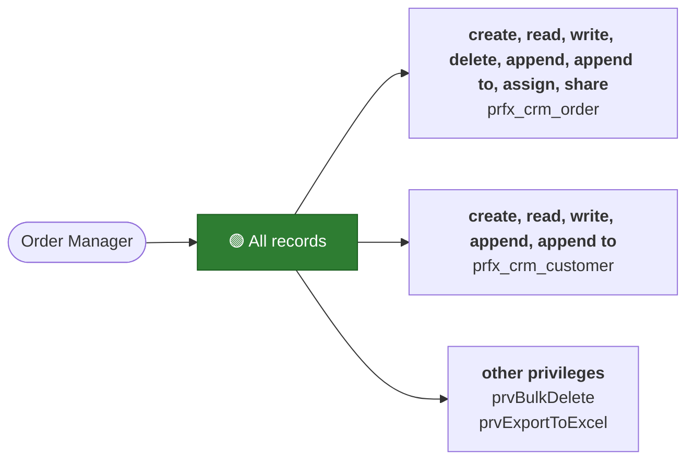

<!-- Generated by dv_security_docs.py from the *.dv.security.yaml files. Do not edit by hand. -->

# Security roles

## Roles

| Role | Description | Member's privilege inheritance | Tables | Other privileges | Source |
|---|---|---|---|---|---|
| [Order Clerk](#order-clerk) | Creates and follows up the orders of their business unit. | Direct user (Basic) access level and team privileges | 3 | 1 | `dataverse/security/roles/order-clerk.dv.security.yaml` |
| [Order Manager](#order-manager) | Manages every order of the organization. | — | 2 | 2 | `dataverse/security/roles/order-manager.dv.security.yaml` |

### Access levels

An access level is the scope of records a privilege applies to.

| Symbol | Level | Model value | The user can act on |
|---|---|---|---|
| 🟢 | Organization | `organization` | all records, whatever their business unit |
| 🔴 | Parent: child business units | `parent_child` | records in the user's business unit and every business unit below it |
| 🔵 | Business unit | `business_unit` | records in the user's business unit |
| ⚪ | User | `user` | records the user owns, records shared with them, and records owned by or shared with their teams |

A privilege the role doesn't hold is shown as -.

## Access by table

What each role can do on each table, grouped by access level (widest first).

| Table | Order Clerk | Order Manager |
|---|---|---|
| `account` | 🟢 read | - |
| `prfx_crm_customer` | 🟢 read, append to | 🟢 create, read, write, append, append to |
| `prfx_crm_order` | 🔵 read ⚪ create, write, append, append to | 🟢 create, read, write, delete, append, append to, assign, share |

## Role details

### Order Clerk

Creates and follows up the orders of their business unit.

Table privileges:

| Table | Create | Read | Write | Delete | Append | Append to | Assign | Share |
|---|---|---|---|---|---|---|---|---|
| `account` | - | 🟢 | - | - | - | - | - | - |
| `prfx_crm_customer` | - | 🟢 | - | - | - | 🟢 | - | - |
| `prfx_crm_order` | ⚪ | 🔵 | ⚪ | - | ⚪ | ⚪ | - | - |

Other privileges:

| Privilege | Level |
|---|---|
| `prvExportToExcel` | 🟢 Organization |

| Property | Value |
|---|---|
| Member's privilege inheritance | Direct user (Basic) access level and team privileges |
| Source | `dataverse/security/roles/order-clerk.dv.security.yaml` |

### Order Manager

Manages every order of the organization.

Table privileges:

| Table | Create | Read | Write | Delete | Append | Append to | Assign | Share |
|---|---|---|---|---|---|---|---|---|
| `prfx_crm_customer` | 🟢 | 🟢 | 🟢 | - | 🟢 | 🟢 | - | - |
| `prfx_crm_order` | 🟢 | 🟢 | 🟢 | 🟢 | 🟢 | 🟢 | 🟢 | 🟢 |

Other privileges:

| Privilege | Level |
|---|---|
| `prvBulkDelete` | 🟢 Organization |
| `prvExportToExcel` | 🟢 Organization |

| Property | Value |
|---|---|
| Member's privilege inheritance | not managed by the model |
| Source | `dataverse/security/roles/order-manager.dv.security.yaml` |
